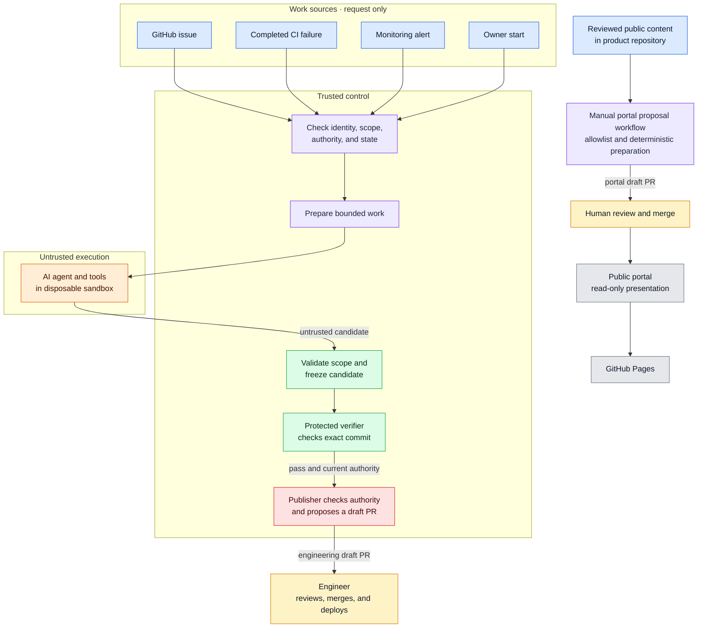

# Architecture overview

Factory Engineering is a governance workflow around an AI coding agent. It separates work intake, trusted decisions, untrusted agent execution, independent verification, and publication.

The colored boxes below are logical responsibilities. They are not separate hosted services. GitHub Actions supplies workflow execution. The separate control repository stores trusted rules and durable state.

## Color legend

  🔵 Blue — work sources
  🟣 Purple — trusted control
  🟠 Orange — untrusted execution
  🟢 Green — validation and verification
  🔴 Red — privileged publication
  ⚪ Gray — infrastructure
  🟡 Yellow — human review

## Demonstrated behavior

Phase 2 reached an exact-commit engineering draft PR through an owner-started retained-candidate continuation. It used a deterministic change and no model call. Automatic forwarding and an uninterrupted end-to-end execution remain unqualified.

The portal proposal workflow is separate from engineering execution. It reads reviewed public content from the product repository. It uses a portal-only App to open a draft content PR. The portal does not connect to Factory Control.

See the [status](../status.md) and [Phase 2 update](../updates/2026-10-13-phase-2-demonstration.md).
