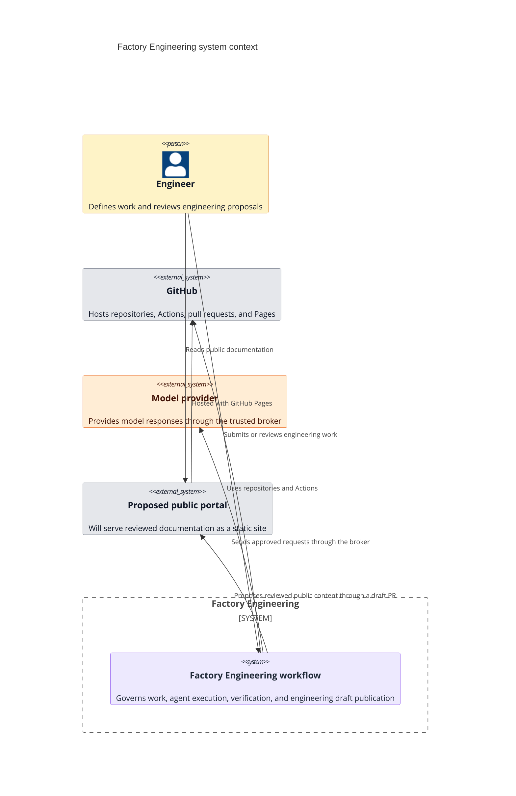
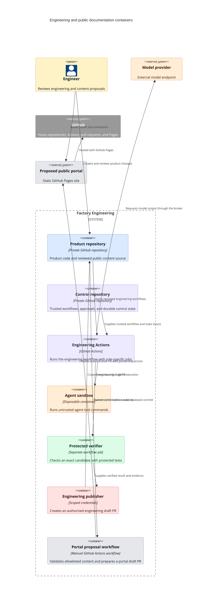
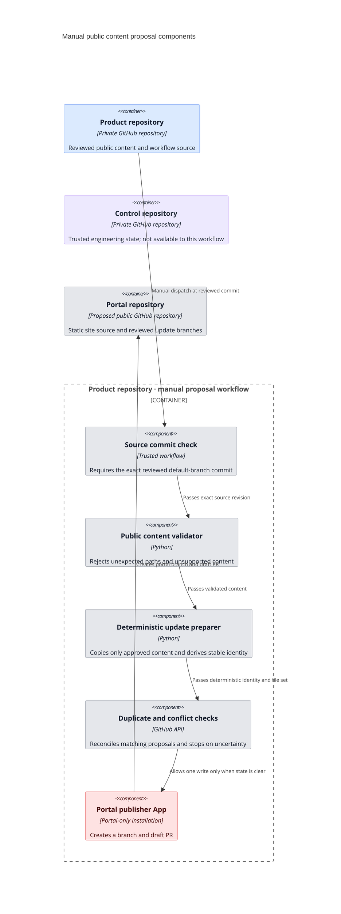

# C4 architecture views

The diagrams use C4 levels to show system context, containers, and components. The named containers and components describe logical boundaries. They are not all separate hosted services.

The Factory color legend is shown in the [architecture overview](overview.md#color-legend). The public portal remains outside the trusted engineering execution flow.

## System context

## Container view

The portal proposal workflow does not read the control repository. It has no connection to engineering execution.

## Component view: portal proposal workflow

The control repository is shown to make the boundary clear. The portal proposal workflow has no relationship to it. The portal cannot authorize work or write back to a Factory repository.

Mermaid documents C4 diagrams as experimental. The local and deployed site builds must render these diagrams before publication.
