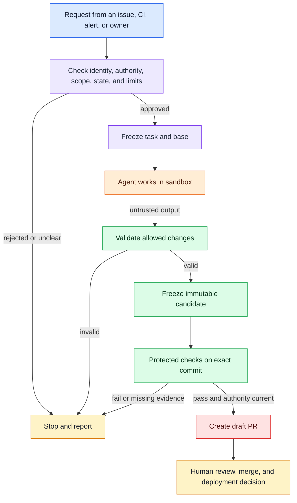

# Logical architecture

These logical components describe the target design. A component is a responsibility boundary, not necessarily a separate service or job.

## Components

| Component | Responsibility | Trust boundary |
|---|---|---|
| Work source | Requests a task. It does not grant authority. | Untrusted input |
| Factory Control | Checks actor, repository, scope, approval, state, and limits. | Trusted decision code |
| Agent runtime | Sends model requests through the approved broker and tool requests to the sandbox. | Trusted orchestration; model output is untrusted |
| Sandbox | Runs agent-requested commands in a disposable workspace. | Untrusted execution |
| Validator | Checks allowed paths, base identity, and candidate structure. | Trusted validation |
| Protected verifier | Tests the exact candidate with protected checks. | Trusted verification |
| Publisher | Rechecks publication authority and opens a draft PR with the verified commit. | Privileged write boundary |
| Human reviewer | Reviews a proposal and decides whether to merge and deploy. | Human authority |

## Target work flow

The public portal is outside this work flow. It presents reviewed documentation and status. It cannot authorize execution or write to the product or control repository.

## Separate documentation update flow

The deployed documentation workflow proposes a portal update from a reviewed product default-branch commit. A person must approve the exact public content in the product repository first, because the portal repository is public and a portal PR is visible as soon as it opens. A validator checks an exact content allowlist. A deterministic preparer creates the proposed update. A portal-only publisher opens a draft PR. A person reviews and merges it. The portal does not connect to Factory Control.

```mermaid
flowchart LR
    Reviewed["Reviewed public source<br/>in product repository"] --> Manual["Manual workflow dispatch<br/>at exact source commit"]
    Manual --> Validate["Validate paths, types,<br/>metadata, and links"]
    Validate --> Prepare["Prepare deterministic update<br/>and stable identity"]
    Prepare --> Draft["Draft PR in portal repository"]
    Draft --> Human["Human review and merge"]
    Human --> Pages["GitHub Pages"]

    classDef source fill:#dbeafe,stroke:#2563eb,color:#0f172a;
    classDef trusted fill:#ede9fe,stroke:#7c3aed,color:#1f2937;
    classDef publish fill:#fee2e2,stroke:#dc2626,color:#450a0a;
    classDef human fill:#fef3c7,stroke:#d97706,color:#111827;
    class Reviewed source;
    class Manual,Validate,Prepare trusted;
    class Draft publish;
    class Human,Pages human;
```

This content flow does not authorize engineering work. Its App token targets only the portal repository. The active `protect-portal-main` ruleset requires a PR and one approval, with no bypass actors. Human merging controls the subsequent Pages deployment; public disclosure occurs when the branch or PR is created.
