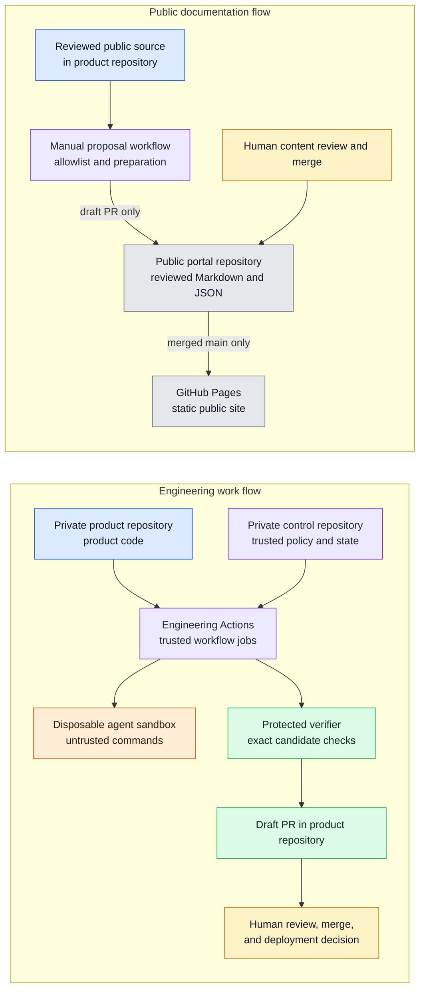

# Physical architecture and deployment

The target deployment uses GitHub repositories, GitHub Actions, a disposable agent sandbox, and GitHub Pages. It adds no portal API or database.

## Repository boundaries

| Repository | Visibility | Responsibility |
|---|---|---|
| `mikara89/factory-engineering` | Private | Product code, architecture source, reviewed public content, public status, and a manually started portal proposal workflow. |
| `mikara89/factory-engineering-control` | Private | Trusted workflows, approvals, ledger, checkpoint, protected verification, and recovery decisions. |
| `mikara89/factory-engineering-portal` | Proposed public repository | Static documentation, public status, roadmap, demonstrations, updates, and GitHub Pages source. |

The portal does not read from the control repository. The product publisher App must be scoped to the portal repository. It needs `contents:write` and `pull-requests:write` to create a branch and draft PR. A portal branch ruleset must block direct App pushes to `main` and require human review. That rule is not configured in this local draft.

## Deployment view

The two flows are separate. The portal proposal workflow reads only allowlisted public content. It does not read the control repository or receive engineering publication credentials.

## Pages publication

When enabled, the Pages workflow will build the site from the portal repository's reviewed `main` branch. A pull request must be reviewed and merged before its content can appear on the site. The branch ruleset must prevent the publisher App from pushing directly to `main`.

The public portal is a presentation layer. It does not call a service, start an agent, or send a command to either Factory repository.
