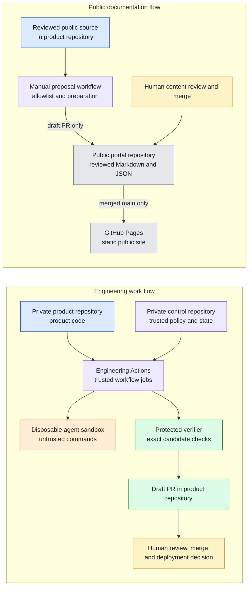

# Physical architecture and deployment

The deployment uses GitHub repositories, GitHub Actions, disposable engineering execution, and GitHub Pages. The engineering diagram includes target responsibilities beyond the qualified scope on the [status page](../status.md). The portal has no API or database.

## Repository boundaries

| Repository | Visibility | Responsibility |
|---|---|---|
| `mikara89/factory-engineering` | Private | Product code, architecture source, reviewed public content, public status, and a manually started portal proposal workflow. |
| `mikara89/factory-engineering-control` | Private | Trusted workflows, approvals, ledger, checkpoint, protected verification, and recovery decisions. |
| `mikara89/factory-engineering-portal` | Public | Static documentation, public status, roadmap, demonstrations, updates, and GitHub Pages source. |

The portal does not read from the control repository. The product workflow requests a portal-scoped App token with `contents:write` and `pull-requests:write`. The publisher creates a branch and draft PR. The active `protect-portal-main` ruleset requires a PR and one approval, with no bypass actors.

## Deployment view

The two flows are separate. The portal proposal workflow reads only allowlisted public content. It does not read the control repository or receive engineering publication credentials.

## Pages publication

GitHub Pages is deployed. The Pages workflow builds PRs and builds and deploys pushes to `main` after merge. The active branch ruleset requires PR review and gives the publisher no bypass. Its required-status-check list does not currently include `build`.

This review controls the Pages deployment. It does not control disclosure. The portal repository is public, so a portal branch or draft PR is visible as soon as it is pushed. A person must approve the exact public content in the private product repository before the proposal workflow pushes it.

The public portal is a presentation layer. It does not call a service, start an agent, or send a command to either Factory repository.
