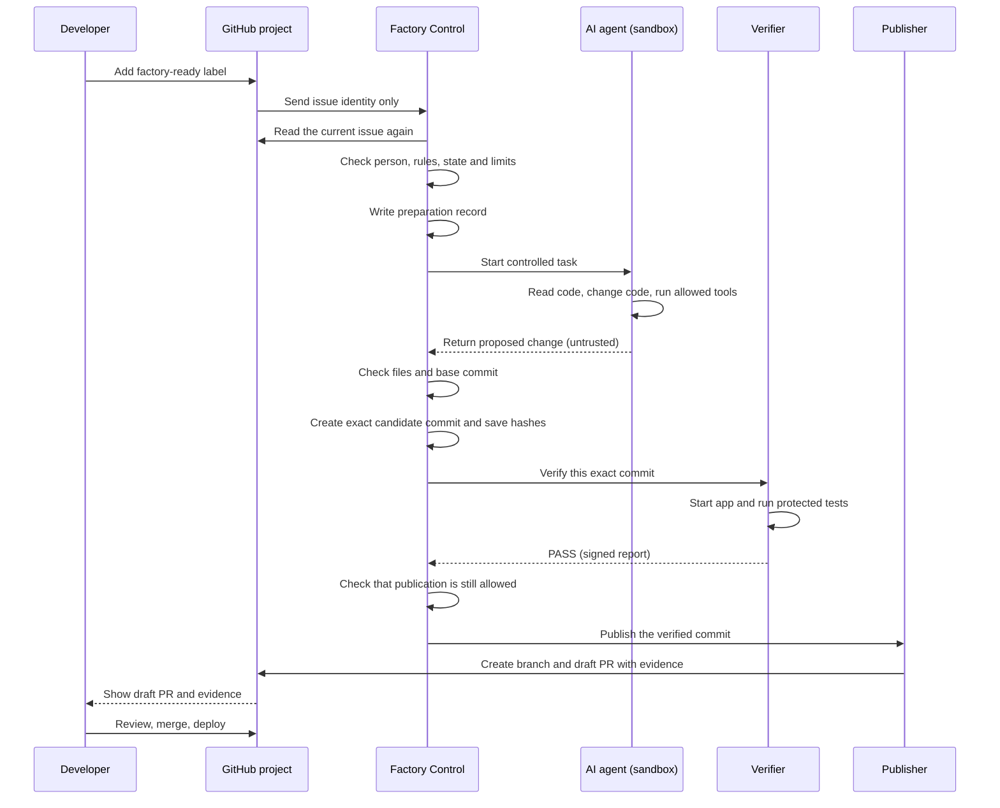
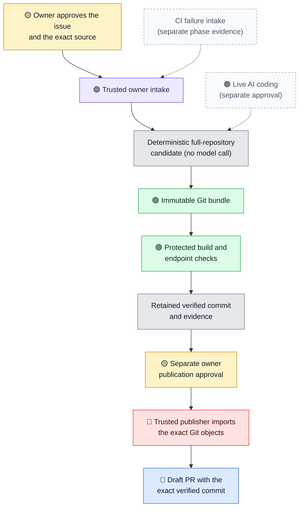
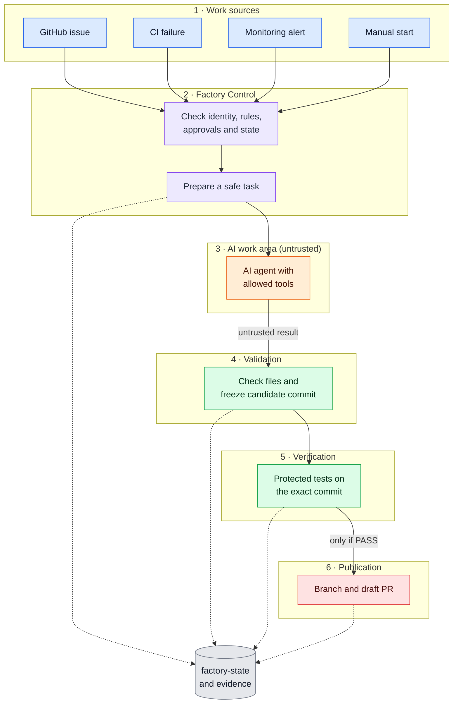
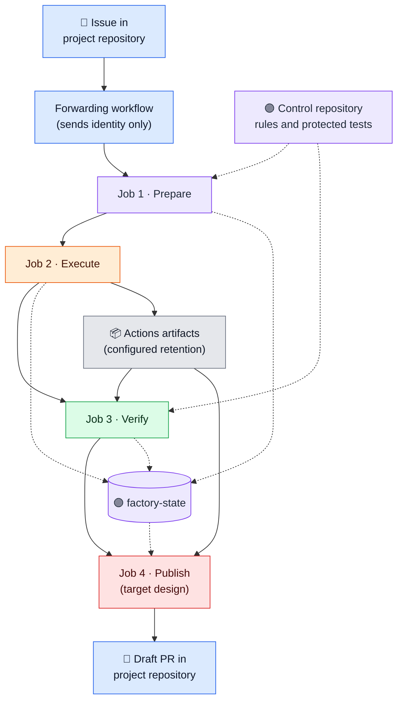
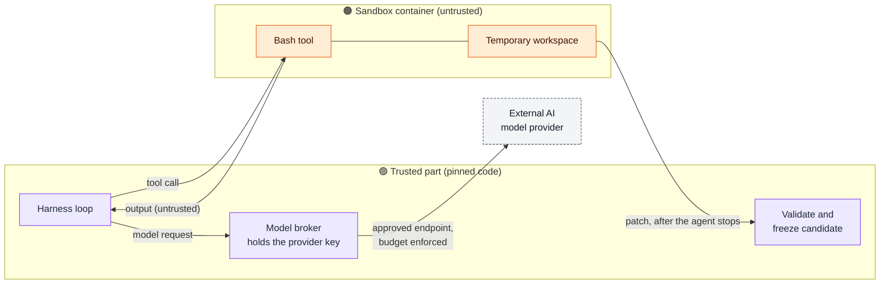
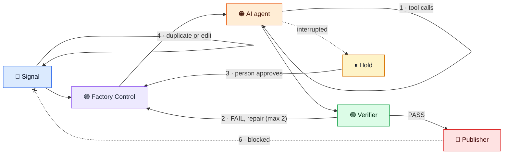
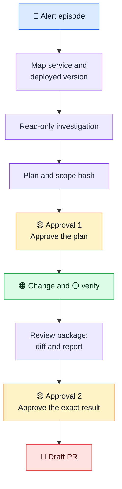
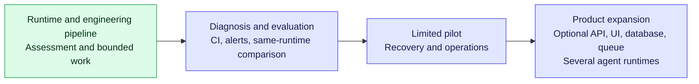

# Factory Engineering Architecture: Simple Guide

<dl class="fe-meta">
  <dt>Project</dt>
  <dd><code>mikara89/factory-engineering</code></dd>
  <dt>Architecture baseline</dt>
  <dd>v1.9</dd>
  <dt>Project status reviewed</dt>
  <dd>18 October 2026</dd>
  <dt>Phase status</dt>
  <dd>Phase 0 demonstrated (assessment complete); Phase 1a accepted and closed; Phase 1b closed with owner exception; Phases 2 and 3 accepted with limitations; Phase 4 accepted with an operational exception and validation limitations.</dd>
  <dt>For</dt>
  <dd>Developers, reviewers and stakeholders. You do not need a security background to read this guide.</dd>
</dl>

!!! warning "Status and scope"

    This guide explains the v1.9 architecture. Most diagrams and workflow descriptions show the target design. They do not mean that every component is implemented or qualified. [What Phase 2 actually ran](#what-phase-2-actually-ran) shows the route that Phase 2 used. Phase 2 demonstrated a deterministic change reaching an engineering draft PR through an owner-started continuation that reused a retained verified candidate. It did not demonstrate a model call, automatic issue forwarding, one uninterrupted issue-to-PR run, merge, or deployment. The original publisher failed; its cause remains unknown. See the [public status](../status.md) for the reviewed milestone record.

---

## Contents

1. [Factory Engineering in one minute](#1-factory-engineering-in-one-minute)
2. [An analogy: a factory with a quality gate](#2-an-analogy-a-factory-with-a-quality-gate)
3. [Follow one example from start to end](#3-follow-one-example-from-start-to-end)
4. [The parts of the system](#4-the-parts-of-the-system)
5. [Trust: who can do what](#5-trust-who-can-do-what)
6. [Where it runs](#6-where-it-runs)
7. [Why there are three repositories](#7-why-there-are-three-repositories)
8. [State, attempts and holds](#8-state-attempts-and-holds)
9. [Loops and their limits](#9-loops-and-their-limits)
10. [Alerts need two approvals](#10-alerts-need-two-approvals)
11. [Why GitHub-native, not a custom platform](#11-why-github-native-not-a-custom-platform)
12. [What can change later](#12-what-can-change-later)
13. [Common questions](#13-common-questions)
14. [Glossary](#14-glossary)

---

## 1. Factory Engineering in one minute

Factory Engineering is **a project that aims to govern AI coding work through control and independent checks**.

It is not an AI coding tool. It is the system *around* the AI coding tool. The target design accepts work from GitHub issues, failed CI builds or monitoring alerts. It gives approved work to an AI agent in a closed environment, then checks the result independently. Only a checked result can become a draft pull request.

Three rules define the target design:

> 1. **The AI does the work, but it does not make the decisions.**
> 2. **The AI result is not trusted until independent checks pass.**
> 3. **People merge and deploy. Factory never does.**

Factory controls:

- which work the AI may start,
- which files and tools the AI may use,
- how much time and model budget each attempt gets,
- how many attempts are allowed,
- how the result is checked,
- when a draft pull request may be created,
- which evidence is saved.

---

## 2. An analogy: a factory with a quality gate

The name "Factory" fits the design. Think of a real factory with a strict quality gate.

| In a real factory | In Factory Engineering |
|---|---|
| A **work order** arrives | A GitHub issue, CI failure or alert arrives |
| The **supervisor** checks the order and decides who may work on it | **Factory Control** checks rules, permissions and state |
| A **worker** builds the part at a closed workbench | The **AI agent** changes code in a temporary sandbox |
| The finished part goes into a **sealed box with a serial number** | Factory freezes the change as an **immutable candidate commit** |
| A **quality inspector** tests the box with their own gauges. The worker cannot touch the gauges | The **verifier** tests that exact commit with **protected tests**. The AI cannot change them |
| Only the **shipping dock** has the keys to the truck | Only the **publisher** has GitHub write permission |
| The **customer** accepts or returns the delivery | The **developer** reviews, merges or rejects the draft PR |

The worker can be very good. The factory still does not ship a part only because the worker says "it is fine".

---

## 3. Follow one example from start to end

We use one example in this guide. The issue is:

> **Login API returns HTTP 500 when the email field is empty.**

| Step | What happens | Why |
|---|---|---|
| 1 | A developer adds the `factory-ready` label to the issue. | Only a label from an allowed person starts work. |
| 2 | GitHub sends only the issue identity to Factory. | Factory does not trust event content. It reads the issue again itself. |
| 3 | Factory checks the person, the rules, the current state and the limits. | Work can be blocked, duplicate or over budget. |
| 4 | Factory writes a preparation record to `factory-state`. | If something fails later, there is a record of what started. |
| 5 | The AI agent reads the code, changes it and runs allowed tools. | This is the only step where the AI works. |
| 6 | Factory checks the changed files and the base commit. Then it creates an exact candidate commit. | The result must be in scope, and it must not change during the tests. |
| 7 | The verifier starts the application and runs protected tests on that exact commit. | The AI cannot change or select these tests. |
| 8 | Factory checks again that publication is still allowed. | The issue can close or the label can go away during the run. |
| 9 | The publisher creates a branch and a draft PR with the verified commit. | Only this job can write to the project repository. |
| 10 | The developer reviews, merges and deploys. | People keep the final decision. |

This sequence shows the target design. Phase 2 did not demonstrate this full flow in one uninterrupted run.

The same flow as a sequence:



**What if the tests fail?** The target design can start a repair attempt with the failure report. The proposed policy allows two repairs per work item. The Phase 2 demonstration did not test repair attempts.

**What if the runner crashes?** Factory puts the work on **hold**. A person must confirm that everything stopped before a new attempt can start. See [section 8](#8-state-attempts-and-holds).

### What Phase 2 actually ran

Phase 2 did not use the full target flow above. It used a shorter route that the owner started and approved at each step. Version 1.9 of the architecture calls it the accepted Phase 2 owner route.



The dashed inputs were not part of the demonstration.

1. The owner approved one issue and the exact source commit. No forwarding workflow started the work.
2. Factory made a deterministic change. No AI model was called.
3. Factory froze the full repository candidate as an immutable Git bundle.
4. The protected verifier built the candidate and passed seven endpoint checks.
5. The original publisher job failed. The cause remains unknown.
6. The owner approved a separate publication-only continuation. It reused the retained verified Git objects and did not rebuild them.
7. The publisher created a draft PR. Its head is the exact verified commit. Nobody merged or deployed it.

| Question | What Phase 2 shows | What it does not show |
|---|---|---|
| Did an AI write the change? | No. The change was deterministic. | Live AI coding quality |
| Does a green workflow prove correctness? | The protected verifier passed although the workflow failed. | Correctness from workflow success alone |
| Is the code merged? | The exact verified commit is in a draft PR. | Merge or deployment |
| Did the issue start the work automatically? | The owner started intake and the publication continuation. | Automatic issue forwarding |
| Did every phase pass as planned? | Phase 1b closed with named evidence limits. | A successful original Phase 1b run |
| Is it ready for production? | One controlled .NET issue-to-draft-PR result | Production remediation, unattended recovery, or general runtime qualification |

---

## 4. The parts of the system

The target design has six parts and one shared record. In the architecture documents, each part is called a **plane**. A plane is only a part with one responsibility and one trust level. It is not a separate server.



### Color legend

| Color | Part | Trust level |
|---|---|---|
| 🔵 Blue | Work sources | Input only. A request, not a permission |
| 🟣 Purple | Factory Control | Trusted. Makes the decisions |
| 🟠 Orange | AI work area | **Untrusted.** Can make mistakes or act unexpectedly |
| 🟢 Green | Validation and verification | Trusted. Checks the result |
| 🔴 Red | Publication | Trusted and privileged. Can write to GitHub |
| ⚪ Gray | Infrastructure and storage | GitHub Actions, artifacts, state |
| 🟡 Yellow | Human | Approval, review, merge, deployment |

### 4.1 Work sources 🔵

**Job:** bring work in. Sources are GitHub issues, failed CI workflows, monitoring alerts and manual starts.

**Important:** a work source only makes a request. A new issue does not give the AI permission to change code.

### 4.2 Factory Control 🟣

**Job:** decide if work may start, and with which limits. This is the most important part.

It answers questions such as:

- Is this repository and this issue allowed?
- Is the person who asked allowed to ask?
- Which files may change?
- Is another attempt already active or on hold?
- Is model budget still available?
- Is a human approval necessary?

Only after these checks does the agent receive work.

### 4.3 AI work area 🟠

**Job:** do the engineering work.

In the target proof-of-concept design:

- DeepSeek Harness runs the agent,
- bash is the only enabled tool,
- the workspace is temporary,
- the agent receives only the public requirements and the source code.

The agent does **not** receive GitHub write tokens, the state-writer key, control repository access, protected tests or the Docker socket.

**Why "untrusted"?** We assume that the AI, or code that it writes, can make mistakes or try something unexpected. The design must stay safe even then.

### 4.4 Validation 🟢

**Job:** check the shape of the result and freeze it.

Validation checks:

- which files changed,
- that no forbidden file changed,
- that the agent used the correct base commit,
- that the output is valid.

Then Factory creates **one immutable candidate commit** and saves its identity:

```text
Candidate commit:  3d58e5f...
Tree:              72ab4cd...
Artifact SHA-256:  b1479d...
```

From this point, everything refers to this exact commit.

### 4.5 Verification 🟢

**Job:** check the behavior of the result, independently.

> **Validation** asks: *Is the change in scope and well formed?*
>
> **Verification** asks: *Does the change do the correct thing?*

In the target design, the verifier runs the candidate application and the protected tests in **separate containers**. The tests come from the control repository. The AI cannot see or change them.

```text
AI changes LoginController.cs
        ↓
Candidate commit is frozen
        ↓
Verifier starts the application (container 1)
        ↓
Protected tests call the API (container 2)
        ↓
Expected: empty email → HTTP 400
Actual:   empty email → HTTP 400
        ↓
PASS
```

If the result is wrong, the report says **FAIL** and no PR is published.

!!! note "What Phase 2 used"

    In Phase 2, the verifier ran the API in one constrained, unprivileged container. Trusted host code sent seven fixed API checks and recorded the report. The two-container design above is still the proposal for live AI work.

Tests that the AI writes are welcome, but they are only extra evidence. They cannot turn a FAIL into a PASS.

### 4.6 Publication 🔴

**Job:** put the verified result on GitHub.

The publisher can create a Factory branch, push the **already verified** commit, create a draft PR and add evidence links.

The publisher never runs AI-generated commands. It does not rebuild or change the commit. The PR head must be the exact commit that passed verification.

**Why a separate job?** It is the only part with write permission to the project repository. If this permission is in one small job, it cannot leak to the AI.

---

## 5. Trust: who can do what

Each part gets only the access that it needs. This table is the security model in one view.

| Part | Write to project repo | Write `factory-state` | Model provider key | See protected tests | Start containers |
|---|:-:|:-:|:-:|:-:|:-:|
| 🟣 Control jobs (prepare, validate, record) | ❌ | ✅ | ❌ | ❌ | ❌ |
| 🟣 Agent job, trusted part (Harness loop, broker) | ❌ | ❌ | ✅ broker only | ❌ | ✅ sandbox only |
| 🟠 Sandbox (AI tool commands, workspace) | ❌ | ❌ | ❌ | ❌ | ❌ |
| 🟢 Verifier supervisor | ❌ | ✅ its report | ❌ | ✅ | ✅ test containers |
| 🟢 Candidate app and test containers | ❌ | ❌ | ❌ | test container only | ❌ |
| 🔴 Publisher | ✅ branch, draft PR, comments | ✅ publication record | ❌ | ❌ | ❌ |

### The AI model is untrusted. The Harness program is trusted.

This difference is important:

- **DeepSeek Harness** is a program. We pin its exact version and run it in the trusted part of the agent job.
- **The AI model** is not trusted. When the model asks for a tool call, Harness sends the command to the **sandbox container**. Only that container runs AI-requested commands.
- **The model broker** keeps the real provider key. It sends model requests to one approved endpoint and stops calls over the budget. The sandbox never sees the key.

Plugins inside Harness add context and limits. They are **not** a security boundary. The security boundary is the sandbox container and the separate jobs.

### The one rule to remember

```text
AI result  ≠  trusted result
```

A result becomes trusted only after Factory validates it and the verifier checks it independently.

---

## 6. Where it runs

The target proof-of-concept design runs most work on GitHub. It uses fresh GitHub-hosted runners and gives each job its own permissions. Phase 2 did not qualify this full job sequence. The forwarding workflow is planned but not qualified. The accepted Phase 2 owner route did not use it.

### The jobs, in order



### Inside Job 2: the trusted part and the sandbox

Job 2 is the only job where the AI works. It has two parts on the same runner.



The sandbox has no network access, no credentials and no Docker socket. Its output goes back to the trusted part as untrusted data.

### What each job does

| Job | Trust | Reads | Writes |
|---|---|---|---|
| **1 · Prepare** | 🟣 Trusted | Issue (read again), rules, current state | Preparation record in `factory-state` |
| **2 · Execute** | 🟣 trusted part + 🟠 sandbox | Task, source code | Candidate commit, artifacts, state update |
| **3 · Verify** | 🟢 Trusted | Candidate artifact, protected tests | Verification report, state update |
| **4 · Publish** (target design) | 🔴 Privileged | Verified commit, state | Branch, draft PR, comments |

In the target design, a **cleanup and final decision** step confirms that all containers and processes stopped. If it cannot confirm this, the work stays on hold. Phase 2 did not qualify this cleanup path.

---

## 7. Why there are three repositories

| | `factory-engineering` | `factory-engineering-control` | `factory-engineering-portal` |
|---|---|---|---|
| **Think of it as** | Factory product source code | Factory security and control | Public documentation site |
| **Contains** | Product code and reviewed public content source | Trusted workflows, Factory rules, protected tests, `factory-state`, recovery decisions | Reviewed public documentation and status snapshots |
| **Who can write** | Project developers | Only the owner and the state-writer GitHub App | Human reviewers merge proposed content |
| **Can a coding agent change it?** | It may work on normal source code | **No** | It can only propose allowlisted content through a draft PR |

The control repository is the **root of trust**. If somebody changes its files without control, they can change what Factory considers safe. The portal is a read-only presentation layer. It does not authorize engineering work or connect to the control repository.

The separation is intentional. An agent may work on normal code, but it must not be able to change the rules that judge its own work.

---

## 8. State, attempts and holds

### Work items and attempts

- A **work item** is one piece of work, for example issue #123. It keeps the same identity even if someone edits the issue.
- An **attempt** is one try at that work. A work item can have several attempts.

In the target design, `factory-state` keeps the trusted status of each work item and attempt:

```text
Issue #123  (work item)
│
├── Attempt 1
│   ├── Prepared
│   ├── Running
│   ├── CandidateCreated
│   ├── VerificationFailed
│   └── Finished
│
└── Attempt 2
    ├── Prepared
    └── Held
```

`factory-state` is a branch in the private control repository. Each change is a Git commit. A change is rejected if the state changed since it was read. This prevents two jobs from writing conflicting updates.

The ledger and a matching checkpoint record the accepted Phase 1 and Phase 2 decisions. They do not establish full runtime qualification.

Actions artifacts keep evidence for their configured retention period. Final manifests and decisions stay in Git in the target design.

### What a hold means

> A **hold** means: *Factory is not sure that it is safe to continue automatically.*

The target design puts work on hold when, for example:

- the runner stopped unexpectedly,
- cleanup could not be confirmed,
- Factory does not know if a PR was created,
- resources from an earlier attempt may still run.

While work is on hold, no new attempt for that work item can start. A person must:

1. confirm that all execution resources stopped,
2. check the saved evidence,
3. check for any existing branch or PR,
4. record the decision, and then approve a new attempt.

**Why not retry automatically?** An automatic retry can create two agents on the same work, or two PRs. The target design requires a person to decide whether another attempt can start. Automatic recovery is planned for a later pilot; Phase 2 did not test it.

---

## 9. Loops and their limits

These loops describe the target design. Phase 2 did not qualify repair, automatic recovery, repeated intake, or approval loops.

Some steps can repeat. Each loop has a limit. One loop is blocked by design.

| # | Loop | Where | What repeats | Limit |
|---|---|---|---|---|
| 1 | Agent work loop | In the agent | Model asks for a tool → sandbox runs it → output goes back | Time cap, model budget and tool policy. The broker stops calls over the budget |
| 2 | Repair loop | After the verifier | Tests fail → failure report → new attempt | Proposed limit: two repairs per work item. Not tested in Phase 2 |
| 3 | Recovery loop | After an interruption | Hold → person checks → new attempt | Target design: a person approves each new attempt |
| 4 | Repeated signal loop | At intake | Duplicate events, issue edits, repeated or resolved alerts | Target design: update the same work item and keep one open PR per source |
| 5 | Approval loop | Before change and before publication | Plan or result changes → new hash → approve again | Target design: each approval matches one hash and has an expiry time |
| 6 | Self-trigger loop | **Blocked** | Factory's own CI failure → intake | Factory branches and verifier runs do not go to intake |



---

## 10. Alerts need two approvals

The target design treats alerts differently from issues. An alert alone does not authorize a repair. Factory asks a person twice. The bounded synthetic Phase 4 flow was accepted on 18 October 2026 with an operational timing exception and validation limits. Production alert integration remains unqualified. The general alert workflow remains target architecture.



- **Approval 1** includes the base commit, the allowed scope, the budget, a hash of the plan and an expiry time.
- **Approval 2** includes the candidate commit SHA, the verifier report digest, the evidence digest and an expiry time.
- An approval is **not valid** if someone edits or deletes it, it expires, its hash is old, or the wrong person gives it.
- The investigation is read-only. It cannot change systems or deploy.
- Deployment stays with people. Factory records separately if the incident resolved after deployment.

---

## 11. Why GitHub-native, not a custom platform

A larger platform could look like this:

```text
Factory API → Database → Message queue → Worker service → Kubernetes
```

That brings many new problems: servers to maintain, database backups, queue recovery, authentication, networking, scaling, worker lifecycle, cost and monitoring.

GitHub supplies most services in the target proof-of-concept design. The proposed deployment is:

```text
GitHub event → GitHub Actions → Factory rules → temporary AI worker → verification → draft PR
```

| Component | Target design | Why |
|---|---|---|
| Workflow orchestration | GitHub Actions | Target workflow engine |
| Factory state | Private Git repository | Target versioned state store |
| AI execution | GitHub-hosted runner and container | Target disposable worker |
| Verification | Separate GitHub-hosted runner | Target independent verification |
| Temporary evidence | Actions artifacts | Retention follows repository settings |
| AI model | External provider | Target model endpoint |
| User interface | GitHub issues, PRs and Actions | Target user interface |
| Database, queue, Kubernetes, public API | **Not now** | Not necessary for one active attempt at a time |

We add custom infrastructure only when there is a clear need.

---

## 12. What can change later

The security model stays the same. The infrastructure around it can grow. The diagram groups capabilities; see [project status](../status.md) for acceptance decisions and limitations.



### The AI runtime can change

DeepSeek Harness is the selected runtime now, but Factory must not depend on it permanently. A common interface sits between Factory and the runtime:

```text
          Factory Engineering
     (rules, state, approvals,
      verification, publication)
                  ↓
     Common agent runtime interface
                  ↓
  ┌──────────────┬────────────┬─────────┬─────────┐
DeepSeek       OpenHands      Codex     Future
Harness
```

When the runtime changes, Factory still owns the rules, state, approvals, verification and publication. Only the execution technology changes. The runtime choice and the model provider choice are also separate decisions.

---

## 13. Common questions

??? question "Can the AI merge or deploy code?"

    No. The target design gives the AI no write access. A publisher can only create a branch, a draft PR and comments. People merge and deploy. Phase 2 did not test merge or deployment.

??? question "What if the AI changes or deletes the tests?"

    The target design keeps protected tests in the control repository and runs them separately. Tests that the AI writes are only extra evidence. Phase 2 did not demonstrate the protected test isolation design.

??? question "Why not trust the agent when it says “all tests pass”?"

    That is a claim, not evidence. In the target design, the verifier checks the exact commit independently and writes its own report.

??? question "What if the AI uses all of its budget?"

    In the target design, the model broker stops further model calls. The attempt ends and Factory records the result.

??? question "What if the runner crashes in the middle of a run?"

    In the target design, the work goes on hold. A person confirms that everything stopped before a new attempt starts.

??? question "What if someone edits the issue during a run?"

    The target design marks the running attempt as stale and prevents publication. Edits do not create a second work item or PR.

??? question "Why a draft PR and not a normal PR?"

    A draft PR shows that the change is a proposal. A person must review it before it can become ready. Phase 2 created a draft PR but did not merge it.

??? question "Does Factory replace code review?"

    No. Factory gives the reviewer a verified change and evidence. The review stays with people.

??? question "Must we use DeepSeek?"

    No. The target architecture allows the runtime and model provider to change. See [section 12](#12-what-can-change-later).

---

## 14. Glossary

Agent
:   An AI program that can use tools to do engineering work, for example read files, change code and run tests.

Agent runtime
:   The program that runs the agent loop and sends tool calls to the sandbox. The v1.9 design names DeepSeek Harness as the selected runtime.

Attempt
:   One try at a work item. A work item can have several attempts.

Broker (model broker)
:   A trusted component that keeps the provider key, sends model requests to one approved endpoint and enforces the budget.

Candidate
:   The exact code change that Factory wants to verify.

Checkpoint
:   A separate trusted cross-check record that matches the latest decision in the permanent decision history (ledger). The matching records together establish phase acceptance.

Control plane (Factory Control)
:   The trusted part that decides if work can start, what is allowed and which attempt is current.

Draft PR
:   A pull request marked as a proposal. It needs human review.

Decision history (ledger)
:   The permanent, ordered record of decisions and actions. A checkpoint is a separate cross-check record.

Evidence
:   The saved records of a run, for example manifests, reports, hashes and logs.

Evidence keeper (custodian)
:   The person responsible for keeping saved records safe and checking the approved backup. This responsibility does not grant approval authority.

Independent review and decision (adjudication)
:   An independent reviewer checks a result using the agreed scoring rules and records the decision.

Scoring rules (rubric)
:   Rules used to decide whether a result is correct.

Readiness testing (qualification)
:   Checking whether something is ready for a specific use. A successful test only supports the use and scope it actually checked.

Safety test for private-data exposure (canary)
:   A test marker and procedure used to check whether protected information can reach an agent.

Test data and setup (fixture)
:   The files and conditions used for testing. Simulated (synthetic) data is created for testing rather than taken from a real incident.

Fixed limits (bounded)
:   Stated limits on time, size, cost or access.

Stop when unsure (fail-closed)
:   Do not continue when required safety or approval evidence cannot be confirmed.

Required check (gate)
:   A condition that must be met before continuing.

Hold
:   A safety state. Factory stops new attempts for a work item until a person resolves the uncertainty.

Immutable candidate
:   A candidate that cannot change during verification. A Git commit SHA identifies it.

Owner route
:   The owner-started route that Phase 2 accepted. The owner approves intake and publication separately. It does not use automatic forwarding.

Plane
:   A part of the system with one responsibility and one trust level. It is not a separate server.

Provenance (where it came from)
:   Information that shows the original source and recorded history of a saved file or result:

    ```text
    workflow run:      12345
    attempt:           2
    base commit:       abc123
    candidate commit:  def456
    artifact SHA-256:  ...
    ```

Publisher
:   The trusted job with permission to create a branch, a draft PR and comments.

Retained candidate
:   A verified candidate whose exact Git objects Factory keeps. A later publication step can use them without rebuilding.

Root of trust
:   The part of the system that keeps the rules and the trusted state. The target design assigns this role to `factory-engineering-control`.

Sandbox
:   The temporary, isolated container where AI-requested commands run. It has no credentials.

Scope hash
:   A hash of the approved plan and allowed changes. An approval is valid only for that hash.

Validation
:   Checks that the AI result is in scope and well formed, then freezes it as a candidate commit.

Verification
:   Independent tests that check if the candidate does the correct thing.

Work item
:   One piece of work, for example one issue, one failed CI run or one alert episode. Its identity stays the same through edits and repeated events.

---

## Summary

```text
Engineering problem
        ↓
Factory checks the rules
        ↓
AI tries to solve it in a sandbox
        ↓
Factory freezes the exact result
        ↓
Independent tests check it
        ↓
Trusted publisher creates a draft PR
        ↓
A developer decides what happens next
```

Everything else in the architecture exists to make this flow **safe, repeatable and traceable**.
