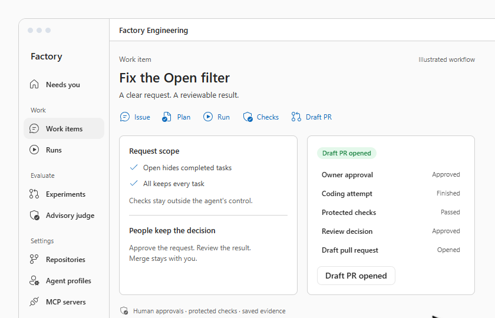
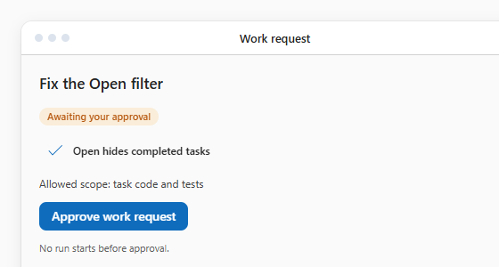
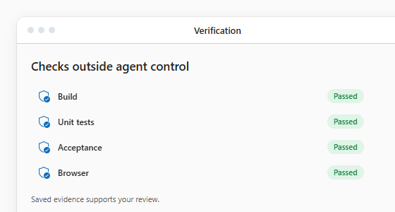
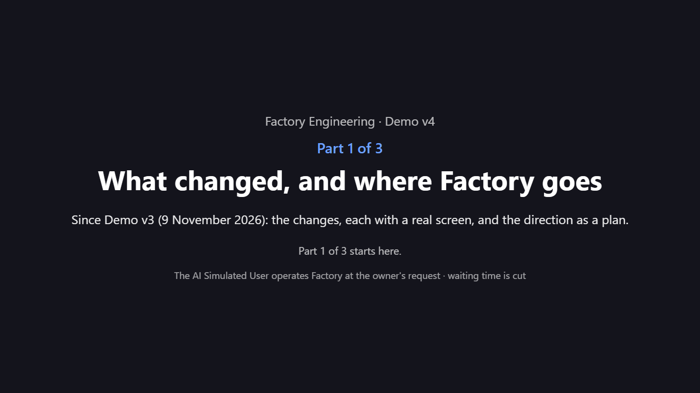
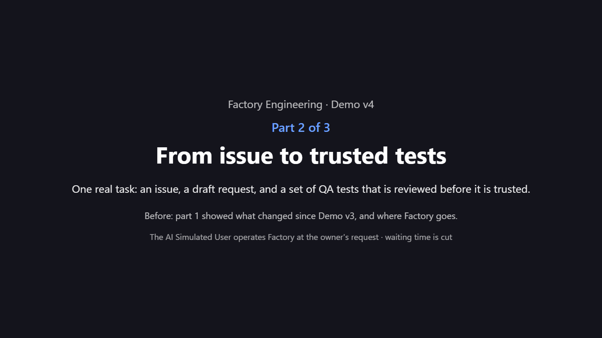
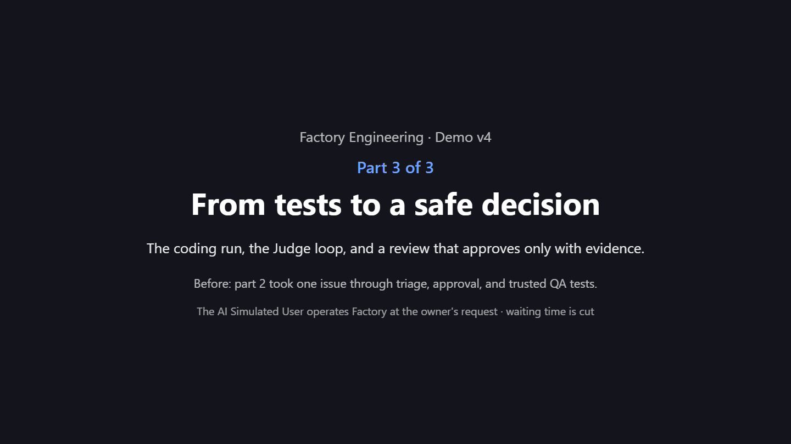

---
hide:
  - navigation
  - toc
---

<section class="fe-showcase-intro" markdown>

Governed AI engineering

# AI writes code. Factory makes it reviewable.

From an approved request to a verified draft PR, with human approvals and checks outside the agent's control.

[Watch the real demo](updates/2026-11-16-factory-demo-v4.md#watch-the-videos){ .md-button .md-button--primary }
[Explore the architecture](mvp/architecture.md){ .md-button }

Manual intake · Explicit spending limits · People keep merge authority

</section>

<figure class="fe-showcase-hero" data-showcase-hero data-asset-base="assets/showcase/">

<figcaption><strong>Illustrated workflow</strong>Simulated content · no live execution</figcaption>
<button class="fe-showcase-playback" type="button" aria-controls="factory-workflow-video" hidden>Play illustration</button>

<picture data-showcase-picture="hero">
<source media="(max-width: 599px) and (prefers-color-scheme: dark)" srcset="assets/showcase/dark-358-poster.png">
<source media="(max-width: 599px)" srcset="assets/showcase/light-358-poster.png">
<source media="(max-width: 839px) and (prefers-color-scheme: dark)" srcset="assets/showcase/dark-688-poster.png">
<source media="(max-width: 839px)" srcset="assets/showcase/light-688-poster.png">
<source media="(prefers-color-scheme: dark)" srcset="assets/showcase/dark-840-poster.png">

</picture>
<video id="factory-workflow-video" class="fe-showcase-loop" muted loop playsinline preload="none" aria-hidden="true" tabindex="-1"></video>

An illustration explains the workflow. Real recordings provide the evidence.

</figure>

<section class="fe-showcase-features" aria-label="How Factory keeps work reviewable">
<article class="fe-showcase-feature">

Human control
<h2>Approve the work. Keep the final decision.</h2>

Approve each request and live attempt. Review the result. Decide whether to merge.

<figure>
<picture data-showcase-picture="approval">
<source media="(max-width: 599px) and (prefers-color-scheme: dark)" srcset="assets/showcase/approval-dark-358.png">
<source media="(max-width: 599px)" srcset="assets/showcase/approval-light-358.png">
<source media="(prefers-color-scheme: dark)" srcset="assets/showcase/approval-dark-560.png">

</picture>
<figcaption>Illustration · the owner approves the scope</figcaption>
</figure>
</article>
<article class="fe-showcase-feature">

Protected checks
<h2>Evidence you can inspect.</h2>

Build, tests, acceptance checks, and browser evidence stay outside the agent's control.

<figure>
<picture data-showcase-picture="checks">
<source media="(max-width: 599px) and (prefers-color-scheme: dark)" srcset="assets/showcase/checks-dark-358.png">
<source media="(max-width: 599px)" srcset="assets/showcase/checks-light-358.png">
<source media="(prefers-color-scheme: dark)" srcset="assets/showcase/checks-dark-560.png">

</picture>
<figcaption>Illustration · passing checks support review</figcaption>
</figure>
</article>
</section>

<section class="fe-showcase-proof" markdown>

The proof is in the recordings

## Watch real Factory work

Demo v4 follows one real task from a GitHub issue to a pending review. An AI Simulated User operated Factory at the owner's request. Every shot identifies live work, a recorded real run, or a scripted step.

<a class="fe-showcase-proof-card" href="updates/2026-11-16-factory-demo-v4/#part-1-what-changed-and-where-factory-goes-5-minutes-53-seconds">

Demo v4 · Part 1<strong>What changed, and where Factory goes</strong>Eight changes since Demo v3 · direction (a plan)Watch Part 1 →
</a>
<a class="fe-showcase-proof-card" href="updates/2026-11-16-factory-demo-v4/#part-2-from-issue-to-trusted-tests-14-minutes-38-seconds">

Demo v4 · Part 2<strong>From issue to trusted tests</strong>Live triage · QA tests · per-test reviewWatch Part 2 →
</a>
<a class="fe-showcase-proof-card" href="updates/2026-11-16-factory-demo-v4/#part-3-from-tests-to-a-safe-decision-8-minutes-2-seconds">

Demo v4 · Part 3<strong>From tests to a safe decision</strong>Coding run · Judge loop · pending reviewWatch Part 3 →
</a>

[Read the Demo v4 evidence and limits](updates/2026-11-16-factory-demo-v4.md#evidence-and-limits){ .fe-showcase-text-link }

</section>

<section class="fe-showcase-detail" markdown>

## A workflow with clear decisions

Read the workflow as text

1. Import a GitHub issue as a work item. Intake stays manual.
2. Let a triage agent draft requirements, checks, and allowed paths. The owner approves the request.
3. Let a separate QA agent write acceptance tests from the approved request. The owner reviews each test against its requirement and approves the test set.
4. Check the exact attempt, base commit, and money limit before each live model call.
5. Run the coding agent in an isolated container with limited file scope.
6. Run build, tests, acceptance checks, and a browser check outside the agent's control.
7. Refuse a candidate that changes files outside its allowed scope.
8. Let the Judge loop score the result and request revisions inside approved limits. The loop never approves.
9. Review the diff, screenshots, requirement verdicts, and four scores. A review without the required evidence stays pending.
10. Start a separately approved attempt when the reviewer requests changes.
11. Open a draft PR with the verified files after approval. People decide merge and deployment.

Factory also compares runs in experiments. The Judge scores a result and can request a revision inside approved limits. The Judge does not decide a requirement or approve a change.

## Evidence and limits

Demo v4 was recorded on 16 November 2026. Read the [MVP status](status.md#mvp) for the milestone record.

- The demo shows one small task in a small demo app. One task does not show general reliability or time savings.
- An AI Simulated User operated Factory at the owner's request. Every review is an agent review. The review is not independent of the Judge.
- The review stayed pending. No draft PR was opened, and nothing was published.
- Time savings are not established.
- The [Demo v3](updates/2026-11-09-factory-demo-v3.md), [Demo v2](updates/2026-11-08-factory-demo-v2.md), and [Demo v1](updates/2026-11-02-mvp-demo-v1.md) recordings remain available with their original limits.

Earlier phases

Phases 0 to 5A tested the workflow with hosted runners and protected verification. Phase 5A stopped incomplete: technical feasibility was demonstrated within the tested scope, but comparative benefit over Baseline was not demonstrated. See the [Legacy POC pages](legacy/index.md).

</section>

<section class="fe-showcase-explore" markdown>

## Explore Factory

- :material-clipboard-check-outline: **[Project status](status.md)**

    Current decisions, milestones, and limitations.

- :material-sitemap-outline: **[MVP architecture](mvp/architecture.md)**

    Components, workflow, and trust boundaries of the MVP.

- :material-archive-outline: **[Legacy POC](legacy/index.md)**

    The proof of concept of Phases 0 to 5A, kept as a historical record.

- :material-map-marker-path: **[Roadmap](roadmap.md)**

    Remaining MVP work and later goals.

</section>

