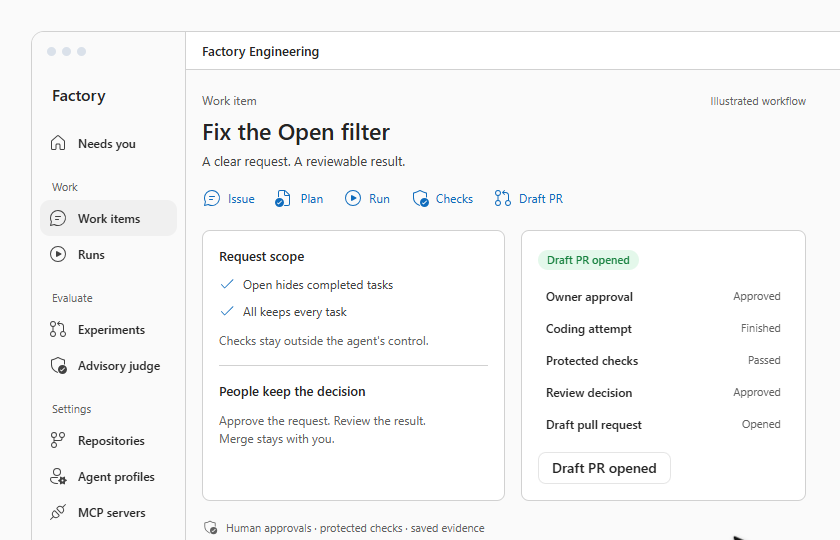
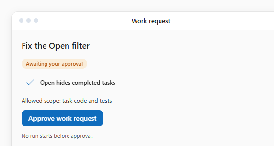
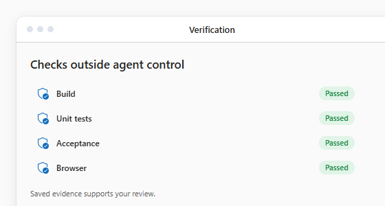
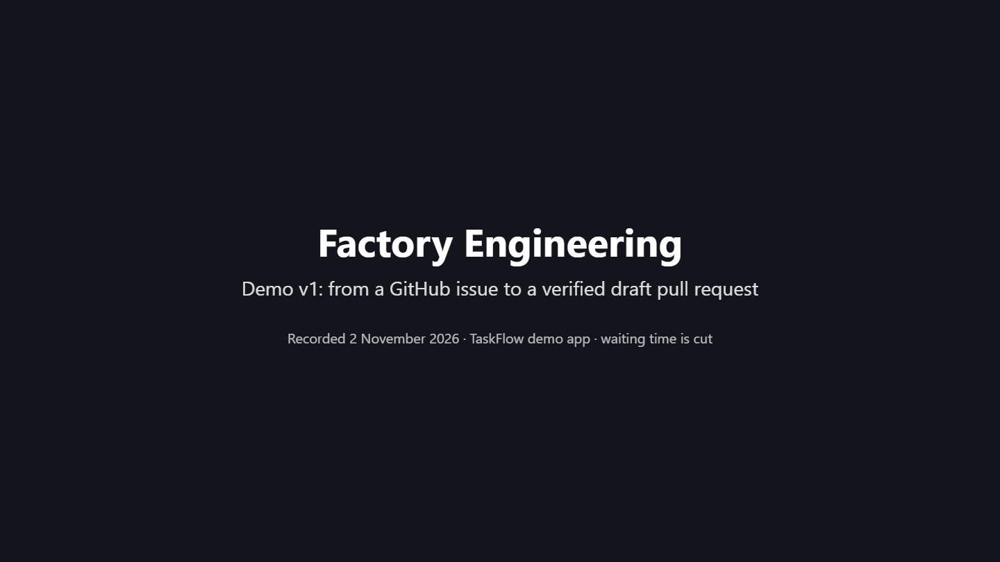
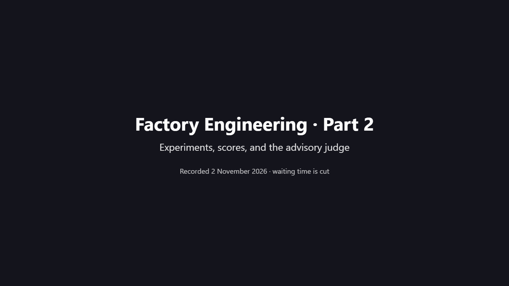

---
hide:
  - navigation
  - toc
---

<section class="fe-showcase-intro" markdown>

Governed AI engineering

# AI writes code. Factory makes it reviewable.

From an approved request to a verified draft PR, with human approvals and checks outside the agent's control.

[Watch the real demo](updates/2026-11-09-factory-demo-v3.md#watch-the-video){ .md-button .md-button--primary }
[Explore the architecture](architecture/overview.md){ .md-button }

Manual intake · Explicit spending limits · People keep merge authority

</section>

<figure class="fe-showcase-hero" data-showcase-hero data-asset-base="assets/showcase/">

<figcaption><strong>Illustrated workflow</strong>Simulated content · no live execution</figcaption>
<button class="fe-showcase-playback" type="button" aria-controls="factory-workflow-video" hidden>Play illustration</button>

<picture data-showcase-picture="hero">
<source media="(max-width: 599px) and (prefers-color-scheme: dark)" srcset="assets/showcase/dark-358-poster.png">
<source media="(max-width: 599px)" srcset="assets/showcase/light-358-poster.png">
<source media="(max-width: 839px) and (prefers-color-scheme: dark)" srcset="assets/showcase/dark-688-poster.png">
<source media="(max-width: 839px)" srcset="assets/showcase/light-688-poster.png">
<source media="(prefers-color-scheme: dark)" srcset="assets/showcase/dark-840-poster.png">

</picture>
<video id="factory-workflow-video" class="fe-showcase-loop" muted loop playsinline preload="none" aria-hidden="true" tabindex="-1"></video>

An illustration explains the workflow. Real recordings provide the evidence.

</figure>

<section class="fe-showcase-features" aria-label="How Factory keeps work reviewable">
<article class="fe-showcase-feature">

Human control
<h2>Approve the work. Keep the final decision.</h2>

Approve each request and live attempt. Review the result. Decide whether to merge.

<figure>
<picture data-showcase-picture="approval">
<source media="(max-width: 599px) and (prefers-color-scheme: dark)" srcset="assets/showcase/approval-dark-358.png">
<source media="(max-width: 599px)" srcset="assets/showcase/approval-light-358.png">
<source media="(prefers-color-scheme: dark)" srcset="assets/showcase/approval-dark-560.png">

</picture>
<figcaption>Illustration · the owner approves the scope</figcaption>
</figure>
</article>
<article class="fe-showcase-feature">

Protected checks
<h2>Evidence you can inspect.</h2>

Build, tests, acceptance checks, and browser evidence stay outside the agent's control.

<figure>
<picture data-showcase-picture="checks">
<source media="(max-width: 599px) and (prefers-color-scheme: dark)" srcset="assets/showcase/checks-dark-358.png">
<source media="(max-width: 599px)" srcset="assets/showcase/checks-light-358.png">
<source media="(prefers-color-scheme: dark)" srcset="assets/showcase/checks-dark-560.png">

</picture>
<figcaption>Illustration · passing checks support review</figcaption>
</figure>
</article>
</section>

<section class="fe-showcase-proof" markdown>

The proof is in the recordings

## Watch real Factory work

Demo v1 shows a small app, a real model run, and the decisions around it. Every shot identifies live work, a recorded real run, or a scripted safety test.

<a class="fe-showcase-proof-card" href="updates/2026-11-02-mvp-demo-v1/#part-1-three-use-cases">

Demo v1 · Part 1<strong>From an issue to a verified draft PR</strong>Success · review and correction · scripted scope refusalWatch the workflow →
</a>
<a class="fe-showcase-proof-card" href="updates/2026-11-02-mvp-demo-v1/#part-2-experiments-scores-and-the-advisory-judge">

Demo v1 · Part 2<strong>Compare runs and inspect advice</strong>Experiments · review scores · advisory judgeWatch the comparison →
</a>

[Read the Demo v1 evidence and limits](updates/2026-11-02-mvp-demo-v1.md){ .fe-showcase-text-link }

</section>

<section class="fe-showcase-detail" markdown>

## A workflow with clear decisions

See the complete workflow

1. Import a GitHub issue as a work item. Intake stays manual.
2. Let a triage agent draft requirements, checks, and allowed paths. The owner approves the request.
3. Check the exact attempt, base commit, and money limit before each live model call.
4. Run the coding agent in an isolated container with limited file scope.
5. Run build, tests, acceptance checks, and a browser check outside the agent's control.
6. Refuse a candidate that changes files outside its allowed scope.
7. Review the diff, screenshots, requirement verdicts, and four scores.
8. Start a separately approved attempt when the reviewer requests changes.
9. Open a draft PR with the verified files after approval. People decide merge and deployment.

Factory also compares runs in experiments and offers an advisory judge. The judge gives advice only. It does not decide a requirement or approve a change.

## Evidence and limits

The videos were recorded on 2 November 2026. Read the [MVP status](status.md#mvp) for the milestone record.

- The demo uses one small app with one deliberate bug.
- Claude Code performed the video reviews at the owner's request. These are not independent human reviews.
- Time savings are not established. Experiment scores are agent scores and were not blind.
- The judge's calibration and benefit are not accepted.
- No PR in the recorded demo was merged, and nothing was deployed.

Earlier phases

Phases 0 to 5A tested the workflow with hosted runners and protected verification. Phase 5A stopped incomplete: technical feasibility was demonstrated within the tested scope, but comparative benefit over Baseline was not demonstrated. See [earlier phases](status.md#earlier-phases).

</section>

<section class="fe-showcase-explore" markdown>

## Explore Factory

- :material-clipboard-check-outline: **[Project status](status.md)**

    Current decisions, milestones, and limitations.

- :material-book-open-page-variant: **[Simple Guide](guide/simple-guide.md)**

    The architecture in plain language.

- :material-sitemap-outline: **[Architecture](architecture/overview.md)**

    Logical boundaries, deployment, and trust.

- :material-map-marker-path: **[Roadmap](roadmap.md)**

    Remaining MVP work and later goals.

</section>

